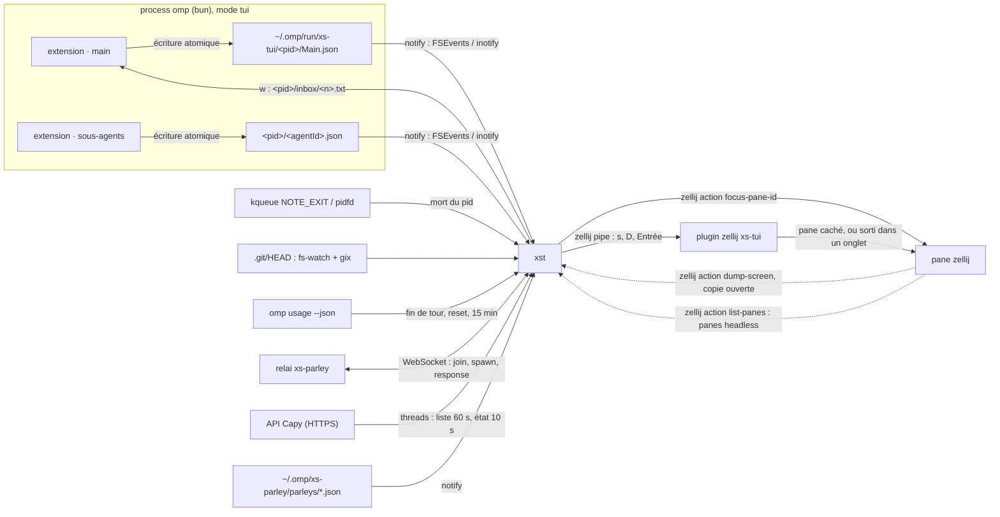

# xs-tui — spécification v1

xs-tui (commande `xst`) est une application TUI de pilotage de harness LLM, développée en Rust avec
Ratatui.
La v1 affiche en temps réel les instances oh-my-pi (omp) en cours, avec leurs sous-agents, et
permet d'aller au pane zellij d'une instance.

## Périmètre v1

- Liste des instances omp interactives (mode `tui`) et de leurs sous-agents, en arbre.
- Chaque ligne indique l'état de l'agent : `idle`, `working`, `blocked`, `error`.
- Mise à jour dynamique : apparition, disparition et changement d'état des instances sans action de l'utilisateur.
- Navigation au clavier, saut vers le pane zellij d'une instance, pliage des sous-agents.
- Sessions épinglées avec `/pin` d'omp : visibles même sans omp en cours, et reprises depuis
  xst, au premier plan ou en arrière-plan.
- Copie en lecture seule de l'écran d'une instance, sous la liste (touche `d`).
- Sessions headless : instances omp affichées dans aucun onglet zellij (touches `s` et `D`).
- Envoi d'un prompt à une instance, sans aller à son pane (touche `w`).
- Filtre de la liste par correspondance floue, comme fzf (touche `f`).
- Jauges de consommation des abonnements Anthropic et OpenAI, à droite de la liste.
- Session-manager xs-parley : reprise headless d'une session omp qu'un master réveille depuis une
  parley (enveloppe `spawn`).
- Threads Capy de l'utilisateur, mêlés aux instances omp : ouverture dans l'app desktop Capy et
  conversation en direct dans la copie `d`.
- Plateformes : macOS et Linux.

Hors périmètre v1 : envoi de commandes à omp (`/…`), affichage du détail de l'état (outil en
cours, question posée, message d'erreur), instances omp non interactives (`omp -p`, jobs omp-cron,
modes `json`/`rpc`).

## Architecture



omp n'expose son état d'exécution que sur le PTY de l'instance (titre OSC 0, OSC 7501) : aucun
fichier ni socket ne le rend lisible par un autre process. Une extension omp publie donc l'état de
chaque agent dans un fichier JSON, et xst surveille ces fichiers.

Le dépôt contient trois composants :

- racine : le binaire Rust `xst` ;
- `extension/` : l'extension omp xs-tui (paquet bun/TypeScript), installée par lien symbolique
  `~/.omp/agent/extensions/xs-tui -> <dépôt>/extension`, comme omp-cron et omp-q ;
- `plugin/` : le plugin zellij xs-tui (Rust, cible `wasm32-wasip1`), compilé par `build.rs` et
  embarqué dans `xst` (voir « Sessions headless »).

xst contient aussi un client xs-parley natif (`src/xsp/`) : voir « Session-manager xs-parley ».

`mise run install` installe `xst` dans `~/.cargo/bin` (`cargo install`) puis l'extension ;
`mise run extension:install` installe seulement l'extension (`bun install` et création ou mise à
jour de ce lien). `mise run extension:check` vérifie que ce lien vise bien `extension/` de ce
dépôt, puis lance un omp jetable (`omp --no-session`, dans un pseudo-terminal et un dossier
temporaire), attend son fichier publié et vérifie qu'il disparaît après `/exit`. La compilation
d'xst demande la cible `wasm32-wasip1`, déclarée dans `mise.toml`.

Le format du fichier évolue dans le même commit côté producteur et côté consommateur.

## Extension omp

### Activation

L'extension publie uniquement pour :

- les sessions main (`agent.kind == "main"`) dont le mode d'hôte est `tui` ;
- les sous-agents (`agent.kind == "sub"`) de ces sessions.

Dans tout autre mode (`print`, `json`, `rpc`), elle ne publie rien.

### Fichiers

Un fichier par agent : `~/.omp/run/xs-tui/<pid>/<agentId>.json`.

Chaque liaison de l'extension (main ou sous-agent) n'écrit que son propre fichier : aucun état
partagé entre sessions, aucune écriture concurrente sur un même fichier.

Toute écriture est atomique : écriture dans un fichier temporaire du même dossier puis `rename`.
Un lecteur ne voit jamais un fichier partiel.

Le dossier `<pid>/` contient aussi la boîte de prompts `inbox/` de la session main (voir « Boîte de
prompts ») : xst ne lit que les fichiers `*.json` du dossier.

L'extension écrit uniquement quand un champ change, jamais à la cadence d'une animation.

### Format

```json
{
  "v": 1,
  "pid": 8215,
  "agent": { "kind": "main", "id": "Main", "name": "main", "depth": 0, "parentId": null },
  "sessionId": "01a18d4a-c0c9-761c-adb9-6c723f16d552",
  "cwd": "/Users/sylvaincolomer/Projects/perso/xs-tui",
  "title": "SPEC: Grill xs-tui SPEC design",
  "state": "working",
  "zellij": { "session": "m1", "paneId": "8" },
  "startedAt": "2026-10-30T14:50:48.905Z",
  "updatedAt": "2026-10-30T15:58:02.114Z"
}
```

| Champ | Contenu |
|---|---|
| `v` | Version du format. Incrémentée à chaque changement incompatible (champ renommé, supprimé ou dont le sens change) ; l'ajout d'un champ ne l'incrémente pas. |
| `pid` | pid du process omp. |
| `agent` | Identité fournie par omp : `kind` (`main` ou `sub`), `id` (ex. `Main`, `OmpInstanceDiscovery`), `name` (type d'agent, ex. `main`, `task`, `scout`), `depth`, `parentId` (`null` pour une racine). |
| `sessionId` | Identifiant de la session omp. |
| `cwd` | Dossier de travail de la session (`sessionManager.getCwd()`), à jour après `/move` et `/wt`. |
| `title` | Titre de la session (`getSessionName()`), tel quel, icône nerd font comprise ; chaîne vide si la session n'a pas encore de titre. |
| `state` | `idle`, `working`, `blocked` ou `error`. |
| `zellij` | `{session, paneId}` lus dans `ZELLIJ_SESSION_NAME` et `ZELLIJ_PANE_ID` ; `null` hors zellij. |
| `startedAt` | Démarrage de l'agent ; sert à l'ordre d'affichage. |
| `updatedAt` | Dernière écriture du fichier. |

La branche git n'est pas publiée : xst la lit lui-même.

### Calcul de l'état

L'extension reconstruit l'état d'exécution d'omp à partir des hooks d'extension :

| Événement | État |
|---|---|
| `session_start` | `idle` |
| `agent_start` | `working` |
| `tool_approval_requested` | `blocked` |
| `tool_approval_resolved` | `working` |
| `tool_execution_start` de l'outil `ask` | `blocked` |
| `tool_execution_end` de l'outil `ask` | `working` |
| `agent_end` avec `stopReason == "error"` | `error` |
| `agent_end` sinon (fin normale, interruption) | `idle` |

L'état `error` est remplacé au tour suivant (`agent_start`).

### Titre et dossier

`title` et `cwd` sont relus à chaque publication d'état et, pour une session main, par un timer de
500 ms qui republie le fichier si `getSessionName()` ou `sessionManager.getCwd()` a changé. Ce timer
capte le titre généré automatiquement après le premier tour, les `/rename` faits au repos, et les
`/move` et `/wt`, qui déplacent la session sans émettre d'événement d'extension. Le dossier est lu
dans `sessionManager` et non dans `ctx.cwd`, copie figée à la création du contexte : celui du timer
date de `session_start`.

Sur `session_switch` (reprise d'une autre session dans le même process), l'extension met à jour
`sessionId`, `cwd` et `title`.

### Cycle de vie

- Un sous-agent supprime son fichier dès qu'il a fini (`agent_end`) : l'arbre ne montre que le
  travail en cours.
- Une session main supprime le dossier `<pid>/` entier à sa fermeture (`session_shutdown`) et à la
  sortie du process.
- Après un crash ou un `kill -9`, le dossier reste ; xst le supprime (voir « Vivacité »).

### Boîte de prompts

La liaison main crée `~/.omp/run/xs-tui/<pid>/inbox/` au `session_start`, avant son premier
fichier publié, et la surveille (`fs.watch`) jusqu'au `session_shutdown`. Son existence indique à
xst que l'instance reçoit des prompts : un omp qui a chargé une version précédente de l'extension
n'en a pas.

- xst y dépose chaque prompt dans un fichier texte UTF-8, écrit sous un nom caché
  (`.<nom>.tmp`) puis renommé en `<horodatage ns sur 20 chiffres>-<compteur sur 6 chiffres>.txt` :
  l'ordre des noms est l'ordre d'envoi.
- À chaque événement du dossier, l'extension lit les fichiers non cachés dans l'ordre des noms ;
  pour chacun, elle le supprime puis appelle `pi.sendUserMessage(<texte>)`, sauf s'il est vide.
  Une lecture en cours en relance une autre au lieu de se doubler.
- `sendUserMessage` sans `deliverAs` agit comme un prompt tapé dans l'éditeur d'omp : au repos, il
  lance un tour ; pendant un tour, il s'insère comme un message de guidage (steer). Le texte est
  envoyé tel quel : ni commande `/…` ni modèle de prompt n'est interprété.

## xst

### Découverte

Les fichiers de l'extension sont la seule source : une instance existe si et seulement si le
dossier `~/.omp/run/xs-tui/<pid>/` contient son fichier et que le pid est vivant. Un omp qui ne
charge pas l'extension, par exemple lancé avant son installation, n'apparaît pas.

xst surveille `~/.omp/run/xs-tui/` récursivement (crate `notify` : FSEvents sur macOS,
inotify sur Linux), relit les fichiers modifiés et reconstruit l'arbre via `agent.parentId`.
xst peut démarrer avant ou après les instances omp.

### Vivacité

- À la découverte d'un pid, xst vérifie que le process est bien un process bun, pour écarter
  un pid réutilisé (libproc sur macOS, `/proc/<pid>` sur Linux).
- xst s'abonne ensuite à la sortie du pid, sans sondage : kqueue `EVFILT_PROC`/`NOTE_EXIT`
  sur macOS, `pidfd_open` + epoll sur Linux.
- À la mort d'un pid, xst retire ses lignes et supprime le dossier `<pid>/`.

### Branche git

xst résout le dépôt depuis le `cwd` avec gix (sans lancer git) et surveille les fichiers HEAD
et index, y compris ceux d'un worktree, pour suivre les changements de branche et de statut. Le
code de lecture de HEAD est recopié de `head_label` d'omp-sessions. Le statut (compteurs) est
recalculé à chaque changement de HEAD ou d'index et toutes les 10 s, comme dans la barre d'état
d'omp, pour voir les modifications de l'arbre de travail.

- Hors dépôt git : aucun segment branche.
- HEAD sur une branche : nom complet (`feat/spoon-feeder-cep-sc-131806`).
- HEAD détaché : `@<sha court>`.
- Couleur comme dans la barre d'état d'omp : verte si le dépôt est propre, jaune s'il a des
  fichiers indexés, modifiés ou non suivis.
- Compteurs non nuls après la branche, comme omp : `*<modifiés>` jaune, `+<indexés>` vert,
  `?<non suivis>` gris. Ils suivent `git status --porcelain` : un fichier indexé puis modifié
  compte dans les deux, un dossier non suivi compte pour un.

Le statut parcourt le worktree : il est calculé hors de la boucle d'affichage, toutes les 10 s
(cadence d'omp), et aussitôt quand HEAD ou l'index changent ou qu'une instance publie. Une
modification de fichier sans publication ni `git add` apparaît donc avec au plus 10 s de retard.

### Format incompatible

Un fichier dont `v` est inconnu ou dont le JSON est illisible produit une ligne d'erreur à la place
de l'instance : `⚠ pid 8215 : format v2 non supporté`. L'instance reste visible.

### Sessions épinglées

La source est le `/pin` d'omp, qui bascule l'épingle de la session courante (`/pin <id>` pour une
autre session) et range les ids épinglés dans `~/.omp/agent/session-pins.json` (tableau JSON, ordre
d'épinglage). xst surveille ce fichier sans sondage. Il l'écrit seulement quand on appuie sur `p`,
avec le même protocole qu'omp (`session-pins.ts`) :

- verrou exclusif `flock` sur `session-pins.json.lock` ; omp utilise le même sur macOS, deux
  écritures simultanées sont donc sérialisées. xst réessaie 20 fois à 50 ms d'intervalle, puis
  affiche « Épingles verrouillées par un autre omp : réessayer » ;
- relecture du fichier sous le verrou, ajout de l'id en fin de liste ou retrait ;
- écriture dans `session-pins.json.<pid>.<n>.tmp` (mode 0600, indentation par tabulation comme
  omp), puis `rename` sur `session-pins.json`.

Un fichier illisible n'est jamais réécrit (« session-pins.json illisible : non modifié ») : omp le
lirait comme vide, et toutes les épingles seraient perdues.

- Session épinglée vivante : une instance dont le `sessionId` publié est épinglé. Elle reste une
  ligne vivante normale, marquée d'une épingle.
- Session dormante : session épinglée qu'aucune instance ne publie. Son dossier et son titre sont
  lus dans son fichier `~/.omp/agent/sessions/*/*_<id>.jsonl` : la ligne 1 porte le titre
  (`{"type":"title",…}`), la ligne 2 l'en-tête avec le `cwd` (`{"type":"session",…}`). Branche et
  compteurs git sont calculés depuis ce `cwd` comme pour une instance.
- Une épingle dont le fichier de session n'existe plus est ignorée.

Avant de reprendre une session dormante, xst vérifie qu'elle n'est pas déjà ouverte : elle
l'est si son bail de propriété `~/.omp/run/session-owners/<id>.lock` est verrouillé (`flock`
exclusif non bloquant, relâché aussitôt ; omp le tient jusqu'à sa mort) ou si une instance publie
son `sessionId`.

## Affichage

### Ligne d'une instance (racine)

```
<état> π  <dernier segment du cwd>   <branche> <titre>
```

- `π` bleu marque une ligne omp (racine ou session dormante), pour la distinguer d'un thread Capy
  (voir « Ligne d'un thread Capy ») ; il est atténué avec le reste d'une instance hors de portée.
- Le dossier est un segment powerline : ` <dossier>` sur fond coloré, suivi de `` dans
  la couleur de ce fond pour la transition. Le fond est bleu ; il est gris foncé pour une instance
  headless (voir « Sessions headless »), y compris sur le segment d'un sous-agent qui en descend.
  Le texte du segment est noir. La branche est colorée selon le statut du dépôt, le titre est en
  texte normal.
- Les titres sont alignés en colonne, au moins deux espaces après la plus large branche.
- Le segment ` <branche>` est absent hors dépôt git.
- À la racine d'un worktree lié, le segment dossier montre le nom du dépôt principal : le nom du
  dossier du worktree reprend la branche, déjà affichée, qu'il soit rangé à côté du dépôt sous le
  nom `<dépôt principal>.<suffixe>` (ex. `backend.services.data-management-service.feature-sc-134990-…`)
  ou par `/wt` d'omp sous `~/.omp/wt/<branche>-<hash>`. Un sous-dossier du worktree garde son propre
  nom ; un clone séparé (`throttler.old`, avec son propre `.git`) n'est pas concerné.
- Le titre est affiché tel quel ; rien tant que la session n'a pas de titre.
- La ligne est tronquée à droite si elle dépasse la largeur.
- Une session épinglée se termine par une épingle `nf-md-pin` (U+F0403) grise, après le titre et
  après un éventuel `▸ N`.

### Ligne d'une session dormante

```
○ π  <dernier segment du cwd>    <branche> <titre> 󰐃
```

- `○` gris à la place de l'indicateur d'état. Le dossier est en gris, sans fond, et un espace
  remplace `` : la ligne garde la largeur d'une racine et son titre reste aligné. Le reste
  suit le format d'une racine (branche colorée, compteurs, titre, épingle grise en fin de ligne).
- Dossier disparu (worktree supprimé) : aucun segment branche.

### Ligne d'un thread Capy

```
<état>   <projet>  <titre>
```

- `` cyan (`nf-fa-cloud`) à la place du `π` des lignes omp.
- Le projet Capy est un segment powerline à fond cyan, texte noir, sans icône ni branche : un
  thread tourne sur une machine Capy, pas dans un dossier local.
- Le titre est aligné sur ceux des racines ; il est en gras quand le thread a une activité non lue
  (`hasUnreads`), comme dans la barre latérale de Capy.
- Pas de sous-agents ni d'épingle.

### Indicateur d'état

| État | Rendu |
|---|---|
| `working` | spinner braille animé `⠋⠙⠹⠸⠼⠴⠦⠧⠇⠏`, jaune, ~100 ms par frame |
| `idle` | `●` vert |
| `blocked` | `●` magenta (en attente d'une approbation ou d'une réponse) |
| `error` | `●` rouge |
| `waiting` (thread Capy seulement : attente de la CI, d'un sous-agent, d'un minuteur) | spinner gris, trois fois plus lent |

Un thread Capy prend l'état omp équivalent : `working` → `working`, `idle` → `idle`, `failed` →
`error`, et `blocked` quand Capy attend l'utilisateur (`needsYou`), quel que soit son statut.

Le redessin périodique n'a lieu que tant qu'au moins un agent visible est `working` ou un thread
Capy `waiting`.

### Ligne d'un sous-agent

```
  ├ <id> <type>
  │ └ ● <id> <type>
  └ <id> <type>
```

- Guides d'arbre : `└` pour le dernier enfant, `├` sinon ; `│` prolonge la branche d'un ancêtre
  qui a encore des frères en dessous.
- Pas d'indicateur : un sous-agent n'existe que pendant son travail. Seul l'état `blocked`
  (approbation en attente) affiche le `●` magenta.
- `<id>` est `agent.id`, `<type>` est `agent.name` en grisé.
- Le dossier et la branche ne sont affichés que si le `cwd` du sous-agent diffère de celui de son
  parent (tâche isolée dans un worktree, `task.isolation.enabled`) ; ils prennent alors le format
  du segment de la racine.

### Ordre

Les racines omp et les threads Capy sont triés ensemble par date de début (`startedAt` d'une
instance, `createdAt` d'un thread) : chacun garde sa position, les nouveaux s'ajoutent en bas. Les
sous-agents suivent le même ordre sous leur parent.

Les sessions dormantes forment un bloc sous les instances et les threads, dans l'ordre de
`session-pins.json`. Fermer un omp épinglé fait descendre sa ligne dans ce bloc ; le reprendre la
fait remonter à sa date de début.

### Instances hors de portée

Une instance qu'Entrée ne peut pas atteindre (autre session zellij que celle d'xst, ou hors
zellij) est affichée atténuée (dim). Son indicateur d'état garde sa couleur.

### Liste vide

Sans aucune instance ni session dormante : « Aucune instance omp » centré, barre du bas visible.
Avec un filtre qui ne garde aucune ligne : « Aucune session ne correspond au filtre ».

### Copie de session

`d` sépare l'écran en deux : la liste en haut, à la hauteur de ses lignes (au plus un tiers de
l'écran, elle défile au-delà), puis une ligne vide, une ligne de séparation et la copie de l'écran
d'omp, sur toute la largeur, jusqu'à la barre du bas. La copie est en lecture seule et suit le
curseur. Sur un thread Capy, elle montre sa conversation (voir « Threads Capy »).

- Source : l'écran visible du pane zellij de l'instance sélectionnée, relu par
  `zellij --session <session> action dump-screen --pane-id terminal_<paneId> --ansi` toutes les
  250 ms tant que la copie est ouverte. Un sous-agent montre le pane de sa racine. Une instance
  d'une autre session zellij est copiée aussi.
- zellij ne redessine pas un onglet qui n'est pas affiché : `zellij subscribe` ne diffuse donc
  rien pour le pane d'un omp dans un autre onglet, d'où la relecture à intervalle fixe.
- Rendu : les couleurs d'omp sont conservées, sans atténuation. omp écrit de haut en bas sans
  forcément remplir l'écran : la copie montre ses dernières lignes non vides, coupées à droite si
  le pane est plus large que la zone. Pas d'historique.
- Ligne de séparation : `── <titre de la session> ───`, puis à droite la taille source et celle de
  la zone (`187×57 → 120×24`) seulement quand la largeur est coupée.
- Messages centrés grisés à la place de la copie : « Session dormante », « Ligne d'erreur »,
  « Instance hors zellij », « Aucune session sélectionnée » (liste vide ; la copie reprend quand
  une instance apparaît), « zellij introuvable », « Copie interrompue : <raison> » (pane fermé,
  erreur de zellij). Après un échec, la copie ne relit plus l'écran jusqu'au prochain changement
  de ligne ou à une réouverture.
- La copie n'est pas mémorisée : xst démarre avec la liste seule.

### Consommation

À droite de la liste, une colonne de jauges reprend ce que montre `/usage` d'omp pour Anthropic
puis OpenAI : un bloc par compte, son nom en gras puis une jauge par fenêtre.

```
Anthropic
5 h        █░░░░░░░░░   7 %   2h54
7 j        ██░░░░░░░░  21 %  1j14h
7 j Fable  ░░░░░░░░░░   4 %  1j14h
```

- Source : `omp usage --json --no-extensions`, dont xst ne garde que les rapports `anthropic` et
  `openai-codex`. omp met ces rapports en cache 5 min et les tient à jour avec les en-têtes de
  réponse des modèles : xst n'a pas d'identifiants. Cette commande ne crée pas de session. Elle
  est lancée avec `OMP_LOG_LEVEL=error` : sinon chaque appel laisserait un journal
  `~/.omp/logs/omp.<jour>.<pid>.log`, que omp garde 5 jours. Quand le cache a expiré, omp
  interroge le fournisseur ; s'il refuse (429), omp renvoie le dernier rapport connu.
- Toutes les fenêtres sont affichées, compteurs secondaires compris (`7 j Fable`). Le nom du
  compte est suivi de son email quand un fournisseur en a plusieurs.
- Barre de 10 cellules, colorée selon le statut d'omp : verte (`ok`), jaune (`warning`), rouge
  (`exhausted`), grise sinon. Puis le pourcentage consommé et le temps avant le reset (`45m`,
  `3h02`, `1j14h`), redessiné à chaque minute.
- Relecture au démarrage, quand une racine finit un tour (`working` → autre état ; au plus une
  fois par minute), 5 s après le prochain reset d'une fenêtre, et toutes les 15 min pour capter la
  consommation faite hors omp (claude.ai, autre machine). L'intervalle est plus long que le cache
  d'omp pour ne pas solliciter l'API de consommation des fournisseurs, qui limite le débit (429).
- La liste est prioritaire : la colonne disparaît si elle ne tient pas à droite de la ligne la
  plus large (plus 3 colonnes d'écart), et la barre du bas l'indique (`jauges masquées`). Les
  jauges qui dépassent la hauteur de la liste, par exemple quand la copie de session est ouverte,
  sont omises : la dernière ligne de la colonne les compte en gris (`+3 jauges masquées`).
- En cas d'échec d'`omp usage`, les dernières jauges restent affichées ; sans jauge, la colonne
  montre le message en gris (« omp introuvable », « omp usage : <raison> »).

### Barre du bas

- À gauche : compteurs par état des lignes affichées, threads Capy compris, ex. `2 ⠹  1 ⠸  1 ●  4 ●`
  avec les couleurs des états ; un thread Capy `waiting` compte dans le compteur gris qui suit
  celui des `working`. Les sessions dormantes ne sont pas comptées. Suivis du dernier échec de
  relecture des threads Capy en rouge (`capy : <raison>`), puis, dans zellij, de l'état du
  session-manager : `manager : N parleys` en gris, ou `manager : <problème>` en rouge (voir
  « Session-manager xs-parley »), puis de `jauges masquées` en gris quand la colonne de
  consommation n'a pas la place de s'afficher.
- À droite : aide des touches, `↑↓/jk naviguer  ⏎ aller au pane  f filtrer  w prompt  s reprendre en fond  D passer en fond  ␣ plier  p épingler  x fermer  d détail  q quitter`.
  Elle est tronquée en premier si la largeur manque.
- Un message temporaire remplace la barre pendant quelques secondes.
- La saisie d'un prompt (`w`) remplace la barre, message temporaire compris, jusqu'à sa fin (voir
  « Envoi de prompt »).

## Interaction

| Touche | Action |
|---|---|
| `↑`/`↓`, `k`/`j` | Déplacer le curseur. |
| `Entrée` | Aller au pane zellij de l'instance (`zellij action focus-pane-id terminal_<paneId>`). Sur un sous-agent, va au pane de sa racine. Sur une instance headless, la sort dans un nouvel onglet ; sur une session dormante, la reprend (voir ci-dessous) ; sur un thread Capy, l'ouvre dans l'app desktop Capy (voir « Threads Capy »). |
| `s` | Reprendre la session dormante en headless, sans quitter xst (voir « Sessions headless »). Sans effet sur une ligne d'erreur. |
| `w` | Saisir un prompt et l'envoyer à l'instance (à sa racine pour un sous-agent) ou au thread Capy, sans quitter xst (voir « Envoi de prompt »). Sans effet sur une ligne d'erreur. |
| `D` | Passer l'instance en headless (celle de sa racine pour un sous-agent). Sans effet sur une ligne d'erreur. |
| `Espace` | Plier ou déplier les sous-agents d'une racine. Sans effet sur une session dormante. |
| `p` | Épingler ou désépingler la session de la ligne (celle de sa racine pour un sous-agent). Sur une session dormante, la désépingle sans confirmation : sa ligne disparaît. Sans effet sur une ligne d'erreur. |
| `x` | Fermer l'instance et son pane, après confirmation (voir ci-dessous). Sur un sous-agent, ferme sa racine. |
| `d` | Ouvrir ou fermer la copie de session (voir « Copie de session »). |
| `f` | Ouvrir la saisie du filtre, avec la requête en cours (voir « Filtre »). |
| `Échap` | Effacer le filtre s'il y en a un, sinon fermer la copie de session. |
| `q`, `Ctrl-C` | Quitter. |

- Les sous-agents sont dépliés par défaut. Une racine repliée affiche le nombre de sous-agents
  (`▸ 3`). L'état de pliage est mémorisé par racine tant qu'xst tourne.
- Le curseur suit l'élément sélectionné (clé `pid` + `agent.id` pour une instance, id de session
  pour une session dormante) quand la liste change. Quand une session change de forme (session
  dormante reprise par Entrée ou `s`, session épinglée fermée), le curseur la suit jusqu'à sa
  nouvelle ligne. Si l'élément disparaît, le curseur passe à son parent, sinon à la ligne voisine.
- Entrée sur une instance d'une autre session zellij affiche « Instance dans la session zellij
  “<nom>” » ; sur une instance hors zellij, « Instance hors zellij ». Aucune autre action.
- Entrée sur une session dormante, comme le script `zellij-resume.sh` d'omp-sessions :
  - déjà ouverte (voir « Sessions épinglées ») : « Session déjà ouverte par un autre omp », aucune
    autre action ;
  - xst hors zellij : « xst hors zellij : reprise impossible » ;
  - sinon : nouvel onglet dans la session zellij d'xst, ouvert dans le `cwd` de la session
    (`$HOME` s'il n'existe plus) :
    `zellij action new-tab --cwd <cwd> -- fish -C "status job-control full; cd <cwd>; and omp --resume <id>"`.
    fish reste ouvert quand omp se termine ; une fois omp relancé, l'extension publie et la ligne
    redevient une instance. `status job-control full` donne à omp son propre groupe de processus :
    sans lui (fish désactive le contrôle des tâches pour `-C`), le Ctrl+Z d'omp gèlerait aussi
    fish, et fermer le pane laisserait omp arrêté sans jamais le réveiller.
- xst reste ouvert après un saut vers un pane : c'est un tableau de bord permanent.
- `x` sur une instance de la session zellij d'xst affiche « Fermer “<titre>” ? x pour confirmer »
  (« cette session » sans titre). Un second `x` dans les 3 s ferme le pane avec `zellij action
  close-pane --pane-id terminal_<paneId>` ; toute autre touche, ou 3 s d'attente, annule. zellij
  envoie alors `SIGHUP` à omp, qui fait sa fermeture normale (session sauvegardée, dossier publié
  supprimé). Une session épinglée devient dormante ; sinon sa ligne disparaît. Une instance hors
  de portée affiche le même message qu'Entrée ; `x` est sans effet sur une session dormante ou une
  ligne d'erreur.
- Une session épinglée sans fichier de session (aucune réponse du modèle : omp ne l'écrit qu'à la
  première) ne peut pas devenir dormante, il n'y a rien à reprendre. Le premier `x` l'annonce à la
  place de la question : « “<titre>” est vide : son épingle sera perdue. x pour fermer ».
- Au démarrage dans zellij, xst renomme son onglet en `xs-tui` (`zellij action
  rename-tab-by-id`, l'onglet étant retrouvé par `ZELLIJ_PANE_ID`). Il ne remet pas l'ancien nom
  en sortant : le hook fish qui nomme les onglets d'après le dépôt le fait à la commande suivante.

### Sessions headless

Une session headless est une instance omp dont le pane zellij est « supprimé » : affiché dans aucun
onglet, il garde son process, sa taille et son écran. zellij ne réserve ces panes qu'aux plugins :
xst embarque le plugin zellij xs-tui (`plugin/`) et l'appelle par
`zellij pipe --plugin file:<wasm> --name xs-tui -- <commande>`, dans un thread.

- Plugin : compilé en `wasm32-wasip1` par `build.rs` et embarqué dans xst, qui l'écrit au
  démarrage, dans zellij, sous `~/.cache/xst/xs-tui-<empreinte>.wasm` en supprimant les versions
  précédentes. zellij garde en mémoire le code d'un plugin par chemin : une nouvelle version
  change de nom pour être chargée, au prix d'une nouvelle demande de permissions.
- Premier appel : zellij lance le plugin dans l'onglet actif, celui d'xst, en pane flottant qui
  demande ses permissions (lire et changer l'état de l'application, lancer des commandes, lire les
  pipes). Ce pane reste caché si la couche flottante de l'onglet l'est : sans réponse au bout de
  3 s, xst l'affiche (`show-floating-panes --tab-id`, `focus-pane-id plugin_<id>`, le pane étant
  retrouvé par son `plugin_url`) et annonce « xs-tui attend ses permissions : y dans son pane pour
  accepter ». Une fois les permissions accordées, le plugin se cache et exécute la commande en
  attente, sans jamais répondre au pipe qui l'attendait : xst cesse de l'attendre après 120 s.
  zellij mémorise l'accord (`permissions.kdl`).
- Commandes, une ligne par élément : le nom puis les arguments. Le plugin répond `ok` ou un
  message d'erreur, affiché dans la barre (« xs-tui : <message> ») :
  - `spawn <cwd> <programme> <arguments…>` : `open_command_pane_background`, puis
    `break_panes_to_new_tab` sans focus et `hide_pane_with_id`. Un pane ouvert en arrière-plan a une
    taille par défaut (92×28) ; passé par un onglet, il prend celle de la session et la garde une
    fois caché. L'onglet vidé se ferme aussitôt.
  - `show <pane>` : `break_panes_to_new_tab`, qui prend le focus.
  - `hide <pane>` : `hide_pane_with_id`. Seul dans son onglet, le pane le quitte et l'onglet se
    ferme.
- Un pane caché est rattaché à l'onglet de plus petit id de la session ; quand cet onglet se
  ferme, il passe dans un autre, sans mourir. Il meurt avec la session zellij.
- État headless : xst lit les panes de terminal `is_suppressed` de
  `zellij action list-panes --tab --state --json`, dans un thread, au démarrage, à chaque
  relecture des fichiers publiés, et 200 ms puis 1 s après chaque commande du plugin. Seules les
  instances de la session zellij d'xst peuvent être headless pour xst.
- `s` sur une session dormante : mêmes vérifications qu'Entrée (« Session déjà ouverte par un
  autre omp »), puis `spawn` de `fish -C "status job-control full; cd <cwd>; and omp --resume <id>"`
  et « “<titre>” reprise en arrière-plan » (« Session reprise en arrière-plan » sans titre). Une
  fois omp relancé, la ligne remonte parmi les instances, avec son état et sa copie `d`. Sur une
  instance headless : « Session déjà en arrière-plan » ; sur une autre instance : « Session déjà
  ouverte : D pour la passer en arrière-plan ».
- `D` sur une instance de la session zellij d'xst : `hide`, et « “<titre>” passée en
  arrière-plan ». Déjà headless : « Session déjà en arrière-plan » ; session dormante : « Session
  dormante : s pour la reprendre en arrière-plan » ; instance hors de portée : même message
  qu'Entrée.
- Entrée sur une instance headless : `show` ; le pane passe dans un nouvel onglet, qui prend le
  focus.
- `x` et la copie `d` traitent un pane headless comme un autre (`close-pane`, `dump-screen`).
- xst hors zellij : « xst hors zellij : arrière-plan impossible » pour `s` et `D`.

### Filtre

`f` ouvre la saisie d'un filtre, `Filtre › <requête>`, curseur en fin de texte, sur la ligne qui
suit la dernière ligne de la liste : sous la liste, avant la copie de session quand elle est
ouverte. La liste se réduit et se trie à chaque caractère tapé, comme dans fzf. Avec la copie
ouverte, la ligne du filtre s'ajoute au tiers d'écran de la liste ; sinon, les jauges de
consommation gardent toute la hauteur à droite.

- Correspondance floue : chaque mot de la requête (séparés par des espaces) doit apparaître dans
  le texte de la session, ses lettres dans l'ordre mais pas forcément côte à côte (`dpl` trouve
  « Déploiement »). Casse intelligente : la casse ne compte que si la requête contient une
  majuscule. Les lettres latines accentuées valent leur lettre de base, dans les deux sens.
- Texte d'une session, tel qu'affiché : dossier (nom du dépôt principal à la racine d'un worktree),
  branche et titre, plus l'id et le type de chacun de ses sous-agents, repliés ou non. Ligne
  d'erreur : `pid <pid> : <message>`.
- Le filtre garde ou retire une session entière : une racine qui correspond reste avec tous ses
  sous-agents, et un sous-agent qui correspond garde sa racine et ses frères.
- Tri par pertinence décroissante, sessions dormantes et lignes d'erreur mêlées aux instances ;
  à pertinence égale, l'ordre sans filtre. Pertinence d'une session : somme, sur les mots de la
  requête, du score de leur meilleure place dans son texte. Score d'une place : 16 points par
  lettre du mot, moins 3 par lettre intercalée entre sa première et sa dernière lettre, plus 8 si
  elle commence un mot du texte (début du texte ou après un caractère non alphanumérique). Places
  candidates : chaque occurrence d'un bloc, et la fenêtre la plus courte qui finit avec la
  première correspondance lettre à lettre (fzf v1) ; à score égal, la plus à gauche.
- Quand la requête change, le curseur passe à la première ligne, la plus pertinente. La liste
  continue de vivre : une instance qui apparaît et correspond s'affiche à son rang.
- Les lettres trouvées sont en gras souligné, couleur et fond conservés, dans le dossier, la
  branche, le titre, l'id et le type d'un sous-agent, et le message d'une ligne d'erreur. Chaque
  champ est surligné seul : pour chaque mot qui y correspond, les lettres de sa meilleure place
  dans ce champ. Un mot qui ne correspond qu'à cheval sur deux champs n'est surligné nulle part.
- Touches de la saisie : caractères, `Retour arrière`, `Ctrl-U` (tout effacer), `↑`/`↓`,
  `Ctrl-P`/`Ctrl-N` et `Ctrl-K`/`Ctrl-J` (déplacer le curseur dans la liste filtrée), `Entrée`
  (garder le filtre et revenir aux commandes), `Échap` ou `Ctrl-C` (effacer le filtre et revenir
  aux commandes, curseur sur la même ligne, liste dans son ordre sans filtre). Un texte collé
  s'ajoute à la requête, ses retours à la ligne remplacés par des espaces.
- Filtre gardé : toutes les commandes portent sur la liste filtrée, et sa ligne reste sous la
  liste, `Filtre ›` atténué, sans curseur. `f` rouvre la saisie avec la même requête ; `Échap`
  l'efface. Une requête vide ou faite d'espaces ne filtre rien et masque la ligne du filtre.
- Le filtre n'est pas mémorisé : xst démarre sans filtre.

### Envoi de prompt

`w` ouvre la saisie d'un prompt pour l'instance de la ligne, celle de sa racine pour un sous-agent :
un sous-agent n'a pas d'éditeur. La saisie passe par la boîte de prompts de l'extension (voir
« Boîte de prompts ») et non par zellij : elle atteint aussi une instance headless, d'une autre
session zellij ou hors zellij, et ne touche pas au texte en cours dans l'éditeur d'omp.

- La barre du bas devient `Prompt → “<titre>” › <texte>` (`Prompt › <texte>` sans titre), curseur
  en fin de texte. Le début d'un texte plus large que la barre est masqué ; un retour à la ligne
  s'affiche `↵`.
- L'instance visée est fixée à l'ouverture : déplacer la liste n'est pas possible pendant la
  saisie, et une liste qui change ne la modifie pas.
- Touches de la saisie : caractères, `Retour arrière` (dernier caractère), `Ctrl-U` (tout effacer),
  `Alt-Entrée` (retour à la ligne), `Entrée` (envoyer), `Échap` ou `Ctrl-C` (abandonner sans
  envoyer). Les autres commandes d'xst attendent la fin de la saisie.
- Un texte collé arrive en un bloc (bracketed paste, activé au démarrage d'xst) : ses retours à la
  ligne restent dans le prompt au lieu de l'envoyer. `\r\n` et `\r` y deviennent `\n`.
- `Entrée` sur un texte vide ou fait d'espaces ferme la saisie sans rien envoyer. Sinon, xst dépose
  le prompt et affiche « Prompt envoyé à “<titre>” » (« Prompt envoyé » sans titre).
- Instance disparue pendant la saisie : « “<titre>” fermée : prompt non envoyé ». Instance sans
  boîte de prompts : « Extension xs-tui trop ancienne dans cette instance : relancer omp ».
- `w` sur une session dormante : « Session dormante : s pour la reprendre en arrière-plan ».
- `w` sur un thread Capy : même saisie, envoyée par l'API de Capy
  (`POST /threads/{id}/message`, `{"text": …, "delivery": "steer"}`) dans un thread, sans
  bloquer l'affichage. *Steer* est le mode par défaut de l'app Capy (le message rejoint l'agent à
  son étape suivante, sans l'interrompre ; au repos, il lance un tour), comme `w` pour omp ; l'API
  interrompt par défaut, d'où le mode toujours précisé. Le résultat s'affiche à la réponse :
  « Prompt envoyé à “<titre>” », ou « Prompt non envoyé : <raison> ». Thread disparu de la liste
  pendant la saisie : « “<titre>” fermée : prompt non envoyé ».

### Session-manager xs-parley

Dans zellij, xst est le session-manager de la machine pour xs-parley (SPEC d'xs-parley § 7.7) : un
membre de rang `M` de chaque parley jointe par les sessions omp de la machine. Un master qui
adresse une demande à une session hors ligne lui envoie une enveloppe `spawn` portant l'id de la
session ; xst la reprend en headless, comme `s`, et répond par une `response`. Le master envoie
ensuite sa demande à la session, une fois en ligne. Hors zellij, xst ne peut rien reprendre en
arrière-plan : pas de manager, ni connexion ni identité.

- Client natif Rust (`src/xsp/`) : clés `xs2`, certificats, `cert_box` (XChaCha20-Poly1305),
  enveloppes HPKE (X25519-HKDF-SHA256, HKDF-SHA256, ChaCha20-Poly1305) et signatures Ed25519
  strictes, au format des sources TypeScript d'xs-parley. Les tests vérifient ces formats sur une
  copie figée des vecteurs `xs-parley/doc/protocol/vectors` (`src/xsp/vectors/`), à
  resynchroniser après `gen-vectors`.
- Identité : `~/.omp/xs-parley/manager.json` (`{v: 1, fp, session}`, `XSP_HOME` remplace
  `~/.omp/xs-parley`) et `keys/<fp>.key`, au format des sessions (0600, dossiers 0700, écriture
  atomique). Créée au premier lancement : `session` est un UUID v7 tiré une fois. Une identité
  incohérente (clé qui ne correspond pas à l'empreinte) n'est jamais écrasée : « xs-parley :
  manager désactivé : identité du manager illisible : <chemin> ».
- Parleys : chaque `parleys/<parley_id>.json` dont un membre porte une clé analysable ; xst
  rejoint avec la clé answer (dérivée de la clé ask si le fichier n'en a pas d'autre), sous l'alias
  `xst-<hôte>` (premier label du nom d'hôte, caractères hors `[A-Za-z0-9_-]` remplacés par `-`,
  32 caractères au plus ; `xst` sans nom d'hôte) et le rôle `session-manager xst (<hôte>)`. Son
  certificat est de rang `M`, signé par la graine answer. Le dossier `parleys/` est surveillé
  (notify) : une parley ajoutée est rejointe, une parley retirée ou modifiée est quittée.
- Relai : une WebSocket par endpoint (`wss://<relai>/ws`, `ws://` pour une parley `--notls`, TLS
  rustls avec les racines du système), dans son thread, reconnectée après 1 s × 2^n (plafond
  60 s, gigue 0-25 %). Une nouvelle paire X25519 à chaque connexion et toutes les 24 h, avec un
  nouveau `join` ; la paire précédente déchiffre encore 10 min. Le manager ne lit ni `members` ni
  `presence`.
- Réception, après les contrôles de l'enveloppe (§ 5.2 d'xs-parley) et l'anti-rejeu (`msg_id`
  vus depuis 10 min) ; chaque refus est journalisé `rejected` dans `audit/<parley_id>.jsonl` :
  - `spawn` d'un certificat de rang autre que `A` : refusé (`spawn_from_non_master`) ;
  - `spawn` dont le texte n'est pas un id de session : `response` `error`, « session invalide » ;
  - `spawn` valide : journalisé `spawn_received`, puis transmis à la boucle d'xst ;
  - `request` : `response` `error`, « session-manager : seules les enveloppes spawn sont
    acceptées » ; les autres kinds sont seulement journalisés.
- Reprise par xst : fichier de session introuvable → `error` « fichier de session introuvable » ;
  session déjà ouverte (instance publiée ou bail `~/.omp/run/session-owners/<id>.lock` tenu) →
  `ok` avec `reason` « déjà ouverte » ; sinon reprise headless (`spawn` du plugin, voir « Sessions
  headless ») dans le dossier de la session (`$HOME` s'il a disparu) et message « “<titre>”
  réveillée par <alias>@<parley> ». Un plugin indisponible répond `error` avec sa raison (« xst
  hors zellij : arrière-plan impossible », « plugin xs-tui : … »).
- Réponse : `ok` dès que l'instance publie son fichier xs-tui ; sans publication en 60 s,
  `error` « l'instance n'a pas publié dans les 60 s » ; si xst ne traite pas la demande en 90 s,
  le manager répond `error` « xst n'a pas répondu ». Chaque réponse est journalisée `spawned` ou
  `spawn_failed`.
- Barre du bas : `manager : N parleys` en gris, N comptant les parleys rejointes ou en attente de
  connexion ; un problème la remplace en rouge : relai injoignable ou coupé (« relai <hôte> :
  <raison> »), identité reprise par une autre connexion (autre xst avec le même `manager.json`,
  jusqu'au prochain changement de `parleys/`), fichiers de parley illisibles.

### Threads Capy

xst affiche les threads [Capy](https://capy.ai) de l'utilisateur dans la liste, mêlés aux instances
omp (voir « Ligne d'un thread Capy » et « Ordre »). `Entrée` ouvre le thread dans l'app desktop
Capy ; `w` lui envoie un prompt (voir « Envoi de prompt ») ; la copie `d` montre sa conversation
(voir ci-dessous) ; `s`, `D`, `x` et `p` affichent « Thread Capy : w pour lui écrire, Entrée pour
l'ouvrir dans Capy, d pour sa conversation ». Le filtre `f` cherche dans le projet et le titre.

- Ouverture : `open capy://app/thread/<id>` (`xdg-open` sur Linux). Le schéma `capy` est celui que
  l'app desktop déclare ; derrière `app`, elle ouvre le chemin de sa page web, ici `/thread/<id>`
  (lu dans le code de l'app : ni l'un ni l'autre n'est documenté). Sans app installée :
  « App Capy introuvable : lien capy:// non ouvert ».

- Source : l'API publique de Capy (`https://api.capy.ai/api/v1`), avec la clé de la variable
  d'environnement `CAPY_API_KEY` (créée dans Capy, Settings → API). Sans clé, xst n'affiche aucun
  thread et n'appelle pas l'API. Les fichiers locaux de l'app Capy (`~/.capy`) ne sont pas lus.
- Threads suivis : ceux de l'utilisateur, non archivés : `participated` ou `member` (lancés, où
  il a écrit ou été mentionné), `archived` faux. Le projet est son nom dans Capy.
- Threads affichés : les threads suivis qui ne sont pas réglés. Un thread est réglé quand il est
  au repos (`idle`), lu (`hasUnreads` faux) et que Capy n'attend rien de l'utilisateur
  (`needsYou` faux). Il reste suivi (relu toutes les 10 s) et réapparaît dès qu'il travaille,
  attend, échoue, a une activité non lue ou une demande. L'app Capy a sa propre section
  « Settled » (marquage manuel, PR mergées, 7 jours sans activité) que l'API publique ne donne
  pas : la règle d'xst est plus large et ne s'appuie que sur l'état du thread.
- Relecture, dans un thread : l'API n'a ni liste pour tout le compte ni flux pour une liste. Toutes
  les 60 s, xst relit les projets puis toutes les pages de threads de chaque projet (100 par page,
  8 projets en parallèle) ; entre-temps, il relit chaque thread affiché toutes les 10 s
  (`GET /threads/{id}`). Un thread nouveau ou rejoint apparaît donc en au plus 60 s, un changement
  d'état en au plus 10 s, et un thread archivé ou supprimé disparaît à sa relecture suivante.
- Échec de relecture (réseau, clé refusée, `429`) : les derniers threads restent affichés et la
  barre du bas montre l'erreur jusqu'à la relecture réussie suivante.
- Conversation dans la copie `d`, quand le curseur est sur un thread Capy :
  - au premier affichage, xst lit la dernière page de la conversation
    (`GET /threads/{id}/messages?before=<plus grand id>&limit=50`), puis ouvre le flux du thread
    (`GET /threads/{id}/stream`, Server-Sent Events) à partir du dernier id d'événement lu, pour ne
    pas rejouer tout l'historique. Les entrées que le flux rejoue remplacent celles de même id ;
  - un seul flux à la fois, ouvert seulement tant que la copie montre ce thread : changer de ligne,
    fermer la copie (`d`, `Échap`) ou quitter xst l'arrête. La lecture bloque jusqu'à la trame
    suivante : le flux d'un thread quitté se ferme à sa trame suivante, au plus 15 s après (Capy
    envoie un battement toutes les 15 s) ;
  - rendu, du plus ancien au plus récent, la fin de la conversation en bas : messages de
    l'utilisateur dans un bandeau sur toute la largeur (fond gris très foncé, couleur 236 de la
    palette 256, barre `▌` cyan à gauche, texte en gras, une ligne de marge au-dessus et en
    dessous), réponses de l'agent en texte normal, chaque entrée d'outil sur une ligne grise
    `⏵ <outil> : <résumé>` (les commandes lancées quand l'outil n'a pas de texte). Le tour en cours
    suit : la réponse en cours d'écriture, puis l'outil appelé, derrière un spinner jaune. Une
    ligne vide précède chaque message et chaque réponse ; les textes sont coupés à la largeur de la
    zone, aux espaces quand c'est possible. 200 entrées au plus sont
    gardées ;
  - une réponse enregistrée remplace ses fragments, une entrée d'outil enregistrée son appel en
    cours ; les fragments restés sans entrée à la fin d'un run (tour interrompu) disparaissent ;
  - coupure sans trame de fin : reprise 2 s plus tard, après le dernier id d'événement lu. Clé
    refusée, thread introuvable ou trame `error` : « Flux interrompu : <raison> » à la place de la
    conversation, sans nouvelle tentative jusqu'au prochain changement de ligne.

## Risques connus

- Sur Linux, omp verrouille `session-pins.json` avec un socket Unix abstrait et non `flock` : un
  `p` dans xst simultané à un `/pin` dans omp peut perdre l'une des deux modifications.
- L'extension recopie la logique d'état d'omp (`event-controller.ts`) faute de hook exposant
  directement son `RunStatus`. Un changement dans omp peut faire diverger l'état affiché sans erreur.
- L'état (publié par l'extension) et la branche (lue par xst) viennent de deux sources
  distinctes.
- Un `/rename`, un `/move` ou un `/wt` fait au repos apparaît avec au plus 500 ms de retard.
- Un prompt envoyé pendant qu'omp attend une réponse (outil `ask`, approbation d'outil) ne répond
  pas à la question : omp le garde comme message de guidage pour la suite du tour.
- La copie de session est relue toutes les 250 ms : un écran qui change entre deux lectures n'y
  apparaît pas, et le pane est coupé s'il est plus grand que la zone de copie.
- Les jauges dépendent du format JSON d'`omp usage`, qui peut évoluer avec omp.
- Une session reprise par un omp qui ne publie pas (lancé avant l'installation de l'extension) et
  restée sans écriture depuis apparaît dormante : omp ne prend son bail qu'à la première écriture.
  Entrée la rouvrirait alors une seconde fois.
- Le plugin contourne zellij 0.45.1 : `break_panes_to_tab_with_id` ne déplace rien et
  `break_panes_to_tab_with_index` perd le pane (process vivant, absent de `list-panes`), d'où le
  passage par un nouvel onglet ; chaque `zellij pipe` lui arrive une seconde fois sans contenu,
  qu'il ignore ; `open_command_pane_background` ignore le dossier demandé, que fixe le `cd` du
  script fish. Une autre version de zellij peut changer ces comportements.
- Le session-manager n'a qu'une identité par machine : deux xst dans zellij se la disputent au
  relai. Le dernier connecté reprend l'empreinte ; l'autre reçoit `replaced`, affiche le problème
  et ne rejoint plus la parley jusqu'au prochain changement de `parleys/`.
- Un porteur de la clé answer peut se déclarer manager (rang `M`) ; il ne gagne que la réception
  des `spawn`, donc au pire un déni de réveil.
- `spawn` crée puis ferme un onglet : il peut apparaître un instant dans la barre d'onglets.
- Les threads Capy dépendent du format de l'API publique de Capy, qui peut évoluer. La relecture
  complète fait une requête par projet et par page de 100 threads toutes les 60 s, plus une par
  thread affiché toutes les 10 s : une organisation avec beaucoup de projets peut atteindre la
  limite de débit de l'API. Capy limite aussi les flux ouverts par clé : avec la copie ouverte,
  parcourir vite plusieurs threads Capy peut laisser jusqu'à 15 s quelques flux en cours de
  fermeture.
