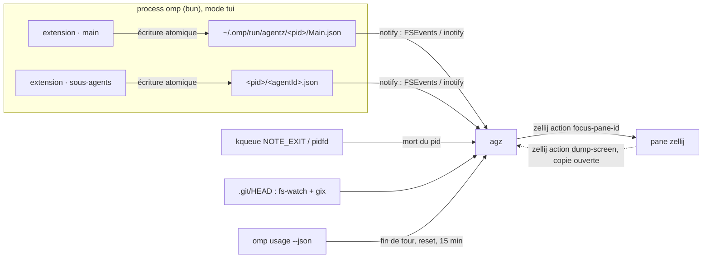

# agz — spécification v1

agz est une application TUI de pilotage de harness LLM, développée en Rust avec Ratatui.
La v1 affiche en temps réel les instances oh-my-pi (omp) en cours, avec leurs sous-agents, et
permet d'aller au pane zellij d'une instance.

## Périmètre v1

- Liste des instances omp interactives (mode `tui`) et de leurs sous-agents, en arbre.
- Chaque ligne indique l'état de l'agent : `idle`, `working`, `blocked`, `error`.
- Mise à jour dynamique : apparition, disparition et changement d'état des instances sans action de l'utilisateur.
- Navigation au clavier, saut vers le pane zellij d'une instance, pliage des sous-agents.
- Sessions épinglées avec `/pin` d'omp : visibles même sans omp en cours, et reprises depuis
  agz.
- Copie en lecture seule de l'écran d'une instance, sous la liste (touche `d`).
- Jauges de consommation des abonnements Anthropic et OpenAI, à droite de la liste.
- Plateformes : macOS et Linux.

Hors périmètre v1 : envoi de prompts ou de commandes à omp, affichage du détail de l'état (outil en
cours, question posée, message d'erreur), instances omp non interactives (`omp -p`, jobs omp-cron,
modes `json`/`rpc`).

## Architecture



omp n'expose son état d'exécution que sur le PTY de l'instance (titre OSC 0, OSC 7501) : aucun
fichier ni socket ne le rend lisible par un autre process. Une extension omp publie donc l'état de
chaque agent dans un fichier JSON, et agz surveille ces fichiers.

Le dépôt contient les deux composants :

- racine : le binaire Rust `agz` ;
- `extension/` : l'extension omp agentz (paquet bun/TypeScript), installée par lien symbolique
  `~/.omp/agent/extensions/agentz -> <dépôt>/extension`, comme omp-cron et omp-q.

`mise run install` installe `agz` dans `~/.cargo/bin` (`cargo install`) puis l'extension ;
`mise run extension:install` installe seulement l'extension (`bun install` et création ou mise à
jour de ce lien). `mise run extension:check` vérifie que ce lien vise bien `extension/` de ce
dépôt, puis lance un omp jetable (`omp --no-session`, dans un pseudo-terminal et un dossier
temporaire), attend son fichier publié et vérifie qu'il disparaît après `/exit`.

Le format du fichier évolue dans le même commit côté producteur et côté consommateur.

## Extension omp

### Activation

L'extension publie uniquement pour :

- les sessions main (`agent.kind == "main"`) dont le mode d'hôte est `tui` ;
- les sous-agents (`agent.kind == "sub"`) de ces sessions.

Dans tout autre mode (`print`, `json`, `rpc`), elle ne publie rien.

### Fichiers

Un fichier par agent : `~/.omp/run/agentz/<pid>/<agentId>.json`.

Chaque liaison de l'extension (main ou sous-agent) n'écrit que son propre fichier : aucun état
partagé entre sessions, aucune écriture concurrente sur un même fichier.

Toute écriture est atomique : écriture dans un fichier temporaire du même dossier puis `rename`.
Un lecteur ne voit jamais un fichier partiel.

L'extension écrit uniquement quand un champ change, jamais à la cadence d'une animation.

### Format

```json
{
  "v": 1,
  "pid": 8215,
  "agent": { "kind": "main", "id": "Main", "name": "main", "depth": 0, "parentId": null },
  "sessionId": "01a18d4a-c0c9-761c-adb9-6c723f16d552",
  "cwd": "/Users/sylvaincolomer/Projects/perso/agent-tui",
  "title": "SPEC: Grill agent-tui SPEC design",
  "state": "working",
  "zellij": { "session": "m1", "paneId": "8" },
  "startedAt": "2026-10-30T14:50:48.905Z",
  "updatedAt": "2026-10-30T15:58:02.114Z"
}
```

| Champ | Contenu |
|---|---|
| `v` | Version du format. Incrémentée à chaque changement incompatible (champ renommé, supprimé ou dont le sens change) ; l'ajout d'un champ ne l'incrémente pas. |
| `pid` | pid du process omp. |
| `agent` | Identité fournie par omp : `kind` (`main` ou `sub`), `id` (ex. `Main`, `OmpInstanceDiscovery`), `name` (type d'agent, ex. `main`, `task`, `scout`), `depth`, `parentId` (`null` pour une racine). |
| `sessionId` | Identifiant de la session omp. |
| `cwd` | Dossier de travail de la session (`sessionManager.getCwd()`), à jour après `/move` et `/wt`. |
| `title` | Titre de la session (`getSessionName()`), tel quel, icône nerd font comprise ; chaîne vide si la session n'a pas encore de titre. |
| `state` | `idle`, `working`, `blocked` ou `error`. |
| `zellij` | `{session, paneId}` lus dans `ZELLIJ_SESSION_NAME` et `ZELLIJ_PANE_ID` ; `null` hors zellij. |
| `startedAt` | Démarrage de l'agent ; sert à l'ordre d'affichage. |
| `updatedAt` | Dernière écriture du fichier. |

La branche git n'est pas publiée : agz la lit lui-même.

### Calcul de l'état

L'extension reconstruit l'état d'exécution d'omp à partir des hooks d'extension :

| Événement | État |
|---|---|
| `session_start` | `idle` |
| `agent_start` | `working` |
| `tool_approval_requested` | `blocked` |
| `tool_approval_resolved` | `working` |
| `tool_execution_start` de l'outil `ask` | `blocked` |
| `tool_execution_end` de l'outil `ask` | `working` |
| `agent_end` avec `stopReason == "error"` | `error` |
| `agent_end` sinon (fin normale, interruption) | `idle` |

L'état `error` est remplacé au tour suivant (`agent_start`).

### Titre et dossier

`title` et `cwd` sont relus à chaque publication d'état et, pour une session main, par un timer de
500 ms qui republie le fichier si `getSessionName()` ou `sessionManager.getCwd()` a changé. Ce timer
capte le titre généré automatiquement après le premier tour, les `/rename` faits au repos, et les
`/move` et `/wt`, qui déplacent la session sans émettre d'événement d'extension. Le dossier est lu
dans `sessionManager` et non dans `ctx.cwd`, copie figée à la création du contexte : celui du timer
date de `session_start`.

Sur `session_switch` (reprise d'une autre session dans le même process), l'extension met à jour
`sessionId`, `cwd` et `title`.

### Cycle de vie

- Un sous-agent supprime son fichier dès qu'il a fini (`agent_end`) : l'arbre ne montre que le
  travail en cours.
- Une session main supprime le dossier `<pid>/` entier à sa fermeture (`session_shutdown`) et à la
  sortie du process.
- Après un crash ou un `kill -9`, le dossier reste ; agz le supprime (voir « Vivacité »).

## agz

### Découverte

Les fichiers de l'extension sont la seule source : une instance existe si et seulement si le
dossier `~/.omp/run/agentz/<pid>/` contient son fichier et que le pid est vivant. Un omp qui ne
charge pas l'extension, par exemple lancé avant son installation, n'apparaît pas.

agz surveille `~/.omp/run/agentz/` récursivement (crate `notify` : FSEvents sur macOS,
inotify sur Linux), relit les fichiers modifiés et reconstruit l'arbre via `agent.parentId`.
agz peut démarrer avant ou après les instances omp.

### Vivacité

- À la découverte d'un pid, agz vérifie que le process est bien un process bun, pour écarter
  un pid réutilisé (libproc sur macOS, `/proc/<pid>` sur Linux).
- agz s'abonne ensuite à la sortie du pid, sans sondage : kqueue `EVFILT_PROC`/`NOTE_EXIT`
  sur macOS, `pidfd_open` + epoll sur Linux.
- À la mort d'un pid, agz retire ses lignes et supprime le dossier `<pid>/`.

### Branche git

agz résout le dépôt depuis le `cwd` avec gix (sans lancer git) et surveille les fichiers HEAD
et index, y compris ceux d'un worktree, pour suivre les changements de branche et de statut. Le
code de lecture de HEAD est recopié de `head_label` d'omp-sessions. Le statut (compteurs) est
recalculé à chaque changement de HEAD ou d'index et toutes les 10 s, comme dans la barre d'état
d'omp, pour voir les modifications de l'arbre de travail.

- Hors dépôt git : aucun segment branche.
- HEAD sur une branche : nom complet (`feat/spoon-feeder-cep-sc-131806`).
- HEAD détaché : `@<sha court>`.
- Couleur comme dans la barre d'état d'omp : verte si le dépôt est propre, jaune s'il a des
  fichiers indexés, modifiés ou non suivis.
- Compteurs non nuls après la branche, comme omp : `*<modifiés>` jaune, `+<indexés>` vert,
  `?<non suivis>` gris. Ils suivent `git status --porcelain` : un fichier indexé puis modifié
  compte dans les deux, un dossier non suivi compte pour un.

Le statut parcourt le worktree : il est calculé hors de la boucle d'affichage, toutes les 10 s
(cadence d'omp), et aussitôt quand HEAD ou l'index changent ou qu'une instance publie. Une
modification de fichier sans publication ni `git add` apparaît donc avec au plus 10 s de retard.

### Format incompatible

Un fichier dont `v` est inconnu ou dont le JSON est illisible produit une ligne d'erreur à la place
de l'instance : `⚠ pid 8215 : format v2 non supporté`. L'instance reste visible.

### Sessions épinglées

La source est le `/pin` d'omp, qui bascule l'épingle de la session courante (`/pin <id>` pour une
autre session) et range les ids épinglés dans `~/.omp/agent/session-pins.json` (tableau JSON, ordre
d'épinglage). agz surveille ce fichier sans sondage. Il l'écrit seulement quand on appuie sur `p`,
avec le même protocole qu'omp (`session-pins.ts`) :

- verrou exclusif `flock` sur `session-pins.json.lock` ; omp utilise le même sur macOS, deux
  écritures simultanées sont donc sérialisées. agz réessaie 20 fois à 50 ms d'intervalle, puis
  affiche « Épingles verrouillées par un autre omp : réessayer » ;
- relecture du fichier sous le verrou, ajout de l'id en fin de liste ou retrait ;
- écriture dans `session-pins.json.<pid>.<n>.tmp` (mode 0600, indentation par tabulation comme
  omp), puis `rename` sur `session-pins.json`.

Un fichier illisible n'est jamais réécrit (« session-pins.json illisible : non modifié ») : omp le
lirait comme vide, et toutes les épingles seraient perdues.

- Session épinglée vivante : une instance dont le `sessionId` publié est épinglé. Elle reste une
  ligne vivante normale, marquée d'une épingle.
- Session dormante : session épinglée qu'aucune instance ne publie. Son dossier et son titre sont
  lus dans son fichier `~/.omp/agent/sessions/*/*_<id>.jsonl` : la ligne 1 porte le titre
  (`{"type":"title",…}`), la ligne 2 l'en-tête avec le `cwd` (`{"type":"session",…}`). Branche et
  compteurs git sont calculés depuis ce `cwd` comme pour une instance.
- Une épingle dont le fichier de session n'existe plus est ignorée.

Avant de reprendre une session dormante, agz vérifie qu'elle n'est pas déjà ouverte : elle
l'est si son bail de propriété `~/.omp/run/session-owners/<id>.lock` est verrouillé (`flock`
exclusif non bloquant, relâché aussitôt ; omp le tient jusqu'à sa mort) ou si une instance publie
son `sessionId`.

## Affichage

### Ligne d'une instance (racine)

```
<état>  <dernier segment du cwd>   <branche> <titre>
```

- Le dossier est un segment powerline : ` <dossier>` sur fond coloré, suivi de `` dans
  la couleur de ce fond pour la transition. La branche est colorée selon le statut du dépôt, le
  titre est en texte normal.
- Les titres sont alignés en colonne, au moins deux espaces après la plus large branche.
- Le segment ` <branche>` est absent hors dépôt git.
- À la racine d'un worktree lié rangé à côté du dépôt principal sous le nom
  `<dépôt principal>.<suffixe>` (ex. `backend.services.data-management-service.feature-sc-134990-…`),
  le segment dossier montre le nom du dépôt principal : le suffixe reprend la branche, déjà
  affichée. Un sous-dossier du worktree garde son propre nom ; un clone séparé (`throttler.old`,
  avec son propre `.git`) n'est pas concerné.
- Le titre est affiché tel quel ; rien tant que la session n'a pas de titre.
- La ligne est tronquée à droite si elle dépasse la largeur.
- Une session épinglée se termine par une épingle `nf-md-pin` (U+F0403) grise, après le titre et
  après un éventuel `▸ N`.

### Ligne d'une session dormante

```
○  <dernier segment du cwd>   <branche> <titre> 󰐃
```

- `○` gris à la place de l'indicateur d'état ; le reste suit le format d'une racine (segment
  dossier, branche colorée, compteurs, titre aligné, épingle grise en fin de ligne).
- Dossier disparu (worktree supprimé) : aucun segment branche.

### Indicateur d'état

| État | Rendu |
|---|---|
| `working` | spinner braille animé `⠋⠙⠹⠸⠼⠴⠦⠧⠇⠏`, jaune, ~100 ms par frame |
| `idle` | `●` vert |
| `blocked` | `●` magenta (en attente d'une approbation ou d'une réponse) |
| `error` | `●` rouge |

Le redessin périodique n'a lieu que tant qu'au moins un agent visible est `working`.

### Ligne d'un sous-agent

```
  ├ <id> <type>
  │ └ ● <id> <type>
  └ <id> <type>
```

- Guides d'arbre : `└` pour le dernier enfant, `├` sinon ; `│` prolonge la branche d'un ancêtre
  qui a encore des frères en dessous.
- Pas d'indicateur : un sous-agent n'existe que pendant son travail. Seul l'état `blocked`
  (approbation en attente) affiche le `●` magenta.
- `<id>` est `agent.id`, `<type>` est `agent.name` en grisé.
- Le dossier et la branche ne sont affichés que si le `cwd` du sous-agent diffère de celui de son
  parent (tâche isolée dans un worktree, `task.isolation.enabled`) ; ils prennent alors le format
  du segment de la racine.

### Ordre

Les racines sont triées par `startedAt` : chaque instance garde sa position, les nouvelles
s'ajoutent en bas. Les sous-agents suivent le même ordre sous leur parent.

Les sessions dormantes forment un bloc sous les instances, dans l'ordre de `session-pins.json`.
Fermer un omp épinglé fait descendre sa ligne dans ce bloc ; le reprendre la fait remonter en bas
des instances.

### Instances hors de portée

Une instance qu'Entrée ne peut pas atteindre (autre session zellij que celle d'agz, ou hors
zellij) est affichée atténuée (dim). Son indicateur d'état garde sa couleur.

### Liste vide

Sans aucune instance ni session dormante : « Aucune instance omp » centré, barre du bas visible.

### Copie de session

`d` sépare l'écran en deux : la liste en haut, à la hauteur de ses lignes (au plus un tiers de
l'écran, elle défile au-delà), puis une ligne vide, une ligne de séparation et la copie de l'écran
d'omp, sur toute la largeur, jusqu'à la barre du bas. La copie est en lecture seule et suit le
curseur.

- Source : l'écran visible du pane zellij de l'instance sélectionnée, relu par
  `zellij --session <session> action dump-screen --pane-id terminal_<paneId> --ansi` toutes les
  250 ms tant que la copie est ouverte. Un sous-agent montre le pane de sa racine. Une instance
  d'une autre session zellij est copiée aussi.
- zellij ne redessine pas un onglet qui n'est pas affiché : `zellij subscribe` ne diffuse donc
  rien pour le pane d'un omp dans un autre onglet, d'où la relecture à intervalle fixe.
- Rendu : les couleurs d'omp sont conservées, sans atténuation. omp écrit de haut en bas sans
  forcément remplir l'écran : la copie montre ses dernières lignes non vides, coupées à droite si
  le pane est plus large que la zone. Pas d'historique.
- Ligne de séparation : `── <titre de la session> ───`, puis à droite la taille source et celle de
  la zone (`187×57 → 120×24`) seulement quand la largeur est coupée.
- Messages centrés grisés à la place de la copie : « Session dormante », « Ligne d'erreur »,
  « Instance hors zellij », « Aucune session sélectionnée » (liste vide ; la copie reprend quand
  une instance apparaît), « zellij introuvable », « Copie interrompue : <raison> » (pane fermé,
  erreur de zellij). Après un échec, la copie ne relit plus l'écran jusqu'au prochain changement
  de ligne ou à une réouverture.
- La copie n'est pas mémorisée : agz démarre avec la liste seule.

### Consommation

À droite de la liste, une colonne de jauges reprend ce que montre `/usage` d'omp pour Anthropic
puis OpenAI : un bloc par compte, son nom en gras puis une jauge par fenêtre.

```
Anthropic
5 h        █░░░░░░░░░   7 %   2h54
7 j        ██░░░░░░░░  21 %  1j14h
7 j Fable  ░░░░░░░░░░   4 %  1j14h
```

- Source : `omp usage --json --no-extensions`, dont agz ne garde que les rapports `anthropic` et
  `openai-codex`. omp met ces rapports en cache 5 min et les tient à jour avec les en-têtes de
  réponse des modèles : agz n'a pas d'identifiants. Cette commande ne crée pas de session. Elle
  est lancée avec `OMP_LOG_LEVEL=error` : sinon chaque appel laisserait un journal
  `~/.omp/logs/omp.<jour>.<pid>.log`, que omp garde 5 jours. Quand le cache a expiré, omp
  interroge le fournisseur ; s'il refuse (429), omp renvoie le dernier rapport connu.
- Toutes les fenêtres sont affichées, compteurs secondaires compris (`7 j Fable`). Le nom du
  compte est suivi de son email quand un fournisseur en a plusieurs.
- Barre de 10 cellules, colorée selon le statut d'omp : verte (`ok`), jaune (`warning`), rouge
  (`exhausted`), grise sinon. Puis le pourcentage consommé et le temps avant le reset (`45m`,
  `3h02`, `1j14h`), redessiné à chaque minute.
- Relecture au démarrage, quand une racine finit un tour (`working` → autre état ; au plus une
  fois par minute), 5 s après le prochain reset d'une fenêtre, et toutes les 15 min pour capter la
  consommation faite hors omp (claude.ai, autre machine). L'intervalle est plus long que le cache
  d'omp pour ne pas solliciter l'API de consommation des fournisseurs, qui limite le débit (429).
- La liste est prioritaire : la colonne disparaît si elle ne tient pas à droite de la ligne la
  plus large (plus 3 colonnes d'écart), et la barre du bas l'indique (`jauges masquées`). Les
  jauges qui dépassent la hauteur de la liste, par exemple quand la copie de session est ouverte,
  sont omises : la dernière ligne de la colonne les compte en gris (`+3 jauges masquées`).
- En cas d'échec d'`omp usage`, les dernières jauges restent affichées ; sans jauge, la colonne
  montre le message en gris (« omp introuvable », « omp usage : <raison> »).

### Barre du bas

- À gauche : compteurs par état, ex. `2 ⠹  1 ●  4 ●` avec les couleurs des états. Les sessions
  dormantes ne sont pas comptées. Suivis de `jauges masquées` en gris quand la colonne de
  consommation n'a pas la place de s'afficher.
- À droite : aide des touches, `↑↓/jk naviguer  ⏎ aller au pane  ␣ plier  p épingler  x fermer  d détail  q quitter`.
  Elle est tronquée en premier si la largeur manque.
- Un message temporaire remplace la barre pendant quelques secondes.

## Interaction

| Touche | Action |
|---|---|
| `↑`/`↓`, `k`/`j` | Déplacer le curseur. |
| `Entrée` | Aller au pane zellij de l'instance (`zellij action focus-pane-id terminal_<paneId>`). Sur un sous-agent, va au pane de sa racine. Sur une session dormante, la reprend (voir ci-dessous). |
| `Espace` | Plier ou déplier les sous-agents d'une racine. Sans effet sur une session dormante. |
| `p` | Épingler ou désépingler la session de la ligne (celle de sa racine pour un sous-agent). Sur une session dormante, la désépingle sans confirmation : sa ligne disparaît. Sans effet sur une ligne d'erreur. |
| `x` | Fermer l'instance et son pane, après confirmation (voir ci-dessous). Sur un sous-agent, ferme sa racine. |
| `d` | Ouvrir ou fermer la copie de session (voir « Copie de session »). |
| `Échap` | Fermer la copie de session. |
| `q`, `Ctrl-C` | Quitter. |

- Les sous-agents sont dépliés par défaut. Une racine repliée affiche le nombre de sous-agents
  (`▸ 3`). L'état de pliage est mémorisé par racine tant qu'agz tourne.
- Le curseur suit l'élément sélectionné (clé `pid` + `agent.id` pour une instance, id de session
  pour une session dormante) quand la liste change. Si l'élément disparaît, le curseur passe à
  son parent, sinon à la ligne voisine.
- Entrée sur une instance d'une autre session zellij affiche « Instance dans la session zellij
  “<nom>” » ; sur une instance hors zellij, « Instance hors zellij ». Aucune autre action.
- Entrée sur une session dormante, comme le script `zellij-resume.sh` d'omp-sessions :
  - déjà ouverte (voir « Sessions épinglées ») : « Session déjà ouverte par un autre omp », aucune
    autre action ;
  - agz hors zellij : « agz hors zellij : reprise impossible » ;
  - sinon : nouvel onglet dans la session zellij d'agz, ouvert dans le `cwd` de la session
    (`$HOME` s'il n'existe plus) :
    `zellij action new-tab --cwd <cwd> -- fish -C "status job-control full; cd <cwd>; and omp --resume <id>"`.
    fish reste ouvert quand omp se termine ; une fois omp relancé, l'extension publie et la ligne
    redevient une instance. `status job-control full` donne à omp son propre groupe de processus :
    sans lui (fish désactive le contrôle des tâches pour `-C`), le Ctrl+Z d'omp gèlerait aussi
    fish, et fermer le pane laisserait omp arrêté sans jamais le réveiller.
- agz reste ouvert après un saut vers un pane : c'est un tableau de bord permanent.
- `x` sur une instance de la session zellij d'agz affiche « Fermer “<titre>” ? x pour confirmer »
  (« cette session » sans titre). Un second `x` dans les 3 s ferme le pane avec `zellij action
  close-pane --pane-id terminal_<paneId>` ; toute autre touche, ou 3 s d'attente, annule. zellij
  envoie alors `SIGHUP` à omp, qui fait sa fermeture normale (session sauvegardée, dossier publié
  supprimé), et la ligne disparaît. Une instance hors de portée affiche le même message qu'Entrée ;
  `x` est sans effet sur une session dormante ou une ligne d'erreur.
- Au démarrage dans zellij, agz renomme son onglet en `agentz` (`zellij action
  rename-tab-by-id`, l'onglet étant retrouvé par `ZELLIJ_PANE_ID`). Il ne remet pas l'ancien nom
  en sortant : le hook fish qui nomme les onglets d'après le dépôt le fait à la commande suivante.

## Risques connus

- Sur Linux, omp verrouille `session-pins.json` avec un socket Unix abstrait et non `flock` : un
  `p` dans agz simultané à un `/pin` dans omp peut perdre l'une des deux modifications.
- L'extension recopie la logique d'état d'omp (`event-controller.ts`) faute de hook exposant
  directement son `RunStatus`. Un changement dans omp peut faire diverger l'état affiché sans erreur.
- L'état (publié par l'extension) et la branche (lue par agz) viennent de deux sources
  distinctes.
- Un `/rename`, un `/move` ou un `/wt` fait au repos apparaît avec au plus 500 ms de retard.
- La copie de session est relue toutes les 250 ms : un écran qui change entre deux lectures n'y
  apparaît pas, et le pane est coupé s'il est plus grand que la zone de copie.
- Les jauges dépendent du format JSON d'`omp usage`, qui peut évoluer avec omp.
- Une session reprise par un omp qui ne publie pas (lancé avant l'installation de l'extension) et
  restée sans écriture depuis apparaît dormante : omp ne prend son bail qu'à la première écriture.
  Entrée la rouvrirait alors une seconde fois.
