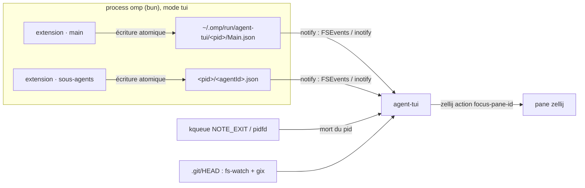

# agent-tui — spécification v1

agent-tui est une application TUI de pilotage de harness LLM, développée en Rust avec Ratatui.
La v1 affiche en temps réel les instances oh-my-pi (omp) en cours, avec leurs sous-agents, et
permet d'aller au pane zellij d'une instance.

## Périmètre v1

- Liste des instances omp interactives (mode `tui`) et de leurs sous-agents, en arbre.
- Chaque ligne indique l'état de l'agent : `idle`, `working`, `blocked`, `error`.
- Mise à jour dynamique : apparition, disparition et changement d'état des instances sans action de l'utilisateur.
- Navigation au clavier, saut vers le pane zellij d'une instance, pliage des sous-agents.
- Plateformes : macOS et Linux.

Hors périmètre v1 : envoi de prompts ou de commandes à omp, affichage du détail de l'état (outil en
cours, question posée, message d'erreur), instances omp non interactives (`omp -p`, jobs omp-cron,
modes `json`/`rpc`).

## Architecture



omp n'expose son état d'exécution que sur le PTY de l'instance (titre OSC 0, OSC 7501) : aucun
fichier ni socket ne le rend lisible par un autre process. Une extension omp publie donc l'état de
chaque agent dans un fichier JSON, et agent-tui surveille ces fichiers.

Le dépôt contient les deux composants :

- racine : le binaire Rust `agent-tui` ;
- `extension/` : l'extension omp (paquet bun/TypeScript), installée par lien symbolique
  `~/.omp/agent/extensions/agent-tui -> <dépôt>/extension`, comme omp-cron et omp-q.

Le format du fichier évolue dans le même commit côté producteur et côté consommateur.

## Extension omp

### Activation

L'extension publie uniquement pour :

- les sessions main (`agent.kind == "main"`) dont le mode d'hôte est `tui` ;
- les sous-agents (`agent.kind == "sub"`) de ces sessions.

Dans tout autre mode (`print`, `json`, `rpc`), elle ne publie rien.

### Fichiers

Un fichier par agent : `~/.omp/run/agent-tui/<pid>/<agentId>.json`.

Chaque liaison de l'extension (main ou sous-agent) n'écrit que son propre fichier : aucun état
partagé entre sessions, aucune écriture concurrente sur un même fichier.

Toute écriture est atomique : écriture dans un fichier temporaire du même dossier puis `rename`.
Un lecteur ne voit jamais un fichier partiel.

L'extension écrit uniquement quand un champ change, jamais à la cadence d'une animation.

### Format

```json
{
  "v": 1,
  "pid": 8215,
  "agent": { "kind": "main", "id": "Main", "name": "main", "depth": 0, "parentId": null },
  "sessionId": "01a18d4a-c0c9-761c-adb9-6c723f16d552",
  "cwd": "/Users/sylvaincolomer/Projects/perso/agent-tui",
  "title": "SPEC: Grill agent-tui SPEC design",
  "state": "working",
  "zellij": { "session": "m1", "paneId": "8" },
  "startedAt": "2026-10-30T14:50:48.905Z",
  "updatedAt": "2026-10-30T15:58:02.114Z"
}
```

| Champ | Contenu |
|---|---|
| `v` | Version du format. Incrémentée à chaque changement incompatible (champ renommé, supprimé ou dont le sens change) ; l'ajout d'un champ ne l'incrémente pas. |
| `pid` | pid du process omp. |
| `agent` | Identité fournie par omp : `kind` (`main` ou `sub`), `id` (ex. `Main`, `OmpInstanceDiscovery`), `name` (type d'agent, ex. `main`, `task`, `scout`), `depth`, `parentId` (`null` pour une racine). |
| `sessionId` | Identifiant de la session omp. |
| `cwd` | Dossier de travail de la session. |
| `title` | Titre de la session (`getSessionName()`), tel quel, icône nerd font comprise ; chaîne vide si la session n'a pas encore de titre. |
| `state` | `idle`, `working`, `blocked` ou `error`. |
| `zellij` | `{session, paneId}` lus dans `ZELLIJ_SESSION_NAME` et `ZELLIJ_PANE_ID` ; `null` hors zellij. |
| `startedAt` | Démarrage de l'agent ; sert à l'ordre d'affichage. |
| `updatedAt` | Dernière écriture du fichier. |

La branche git n'est pas publiée : agent-tui la lit lui-même.

### Calcul de l'état

L'extension reconstruit l'état d'exécution d'omp à partir des hooks d'extension :

| Événement | État |
|---|---|
| `session_start` | `idle` |
| `agent_start` | `working` |
| `tool_approval_requested` | `blocked` |
| `tool_approval_resolved` | `working` |
| `tool_execution_start` de l'outil `ask` | `blocked` |
| `tool_execution_end` de l'outil `ask` | `working` |
| `agent_end` avec `stopReason == "error"` | `error` |
| `agent_end` sinon (fin normale, interruption) | `idle` |

L'état `error` est remplacé au tour suivant (`agent_start`).

### Titre

`title` est relu à chaque publication d'état et, pour une session main, par un timer de 5 s qui
republie le fichier si `getSessionName()` a changé. Ce timer capte le titre généré
automatiquement après le premier tour et les `/rename` faits au repos.

Sur `session_switch` (reprise d'une autre session dans le même process), l'extension met à jour
`sessionId`, `cwd` et `title`.

### Cycle de vie

- Un sous-agent supprime son fichier dès qu'il a fini (`agent_end`) : l'arbre ne montre que le
  travail en cours.
- Une session main supprime le dossier `<pid>/` entier à sa fermeture (`session_shutdown`) et à la
  sortie du process.
- Après un crash ou un `kill -9`, le dossier reste ; agent-tui le supprime (voir « Vivacité »).

## agent-tui

### Découverte

Les fichiers de l'extension sont la seule source : une instance existe si et seulement si le
dossier `~/.omp/run/agent-tui/<pid>/` contient son fichier et que le pid est vivant. Un omp qui ne
charge pas l'extension, par exemple lancé avant son installation, n'apparaît pas.

agent-tui surveille `~/.omp/run/agent-tui/` récursivement (crate `notify` : FSEvents sur macOS,
inotify sur Linux), relit les fichiers modifiés et reconstruit l'arbre via `agent.parentId`.
agent-tui peut démarrer avant ou après les instances omp.

### Vivacité

- À la découverte d'un pid, agent-tui vérifie que le process est bien un process bun, pour écarter
  un pid réutilisé (libproc sur macOS, `/proc/<pid>` sur Linux).
- agent-tui s'abonne ensuite à la sortie du pid, sans sondage : kqueue `EVFILT_PROC`/`NOTE_EXIT`
  sur macOS, `pidfd_open` + epoll sur Linux.
- À la mort d'un pid, agent-tui retire ses lignes et supprime le dossier `<pid>/`.

### Branche git

agent-tui résout le dépôt depuis le `cwd` avec gix (sans lancer git) et surveille les fichiers HEAD
et index, y compris ceux d'un worktree, pour suivre les changements de branche et de statut. Le
code de lecture de HEAD est recopié de `head_label` d'omp-sessions.

- Hors dépôt git : aucun segment branche.
- HEAD sur une branche : nom complet (`feat/spoon-feeder-cep-sc-131806`).
- HEAD détaché : `@<sha court>`.
- Couleur comme dans la barre d'état d'omp : verte si le dépôt est propre, jaune s'il a des
  fichiers indexés, modifiés ou non suivis.

Le statut parcourt le worktree : il est calculé hors de la boucle d'affichage, toutes les 10 s
(cadence d'omp), et aussitôt quand HEAD ou l'index changent ou qu'une instance publie. Une
modification de fichier sans publication ni `git add` apparaît donc avec au plus 10 s de retard.

### Format incompatible

Un fichier dont `v` est inconnu ou dont le JSON est illisible produit une ligne d'erreur à la place
de l'instance : `⚠ pid 8215 : format v2 non supporté`. L'instance reste visible.

## Affichage

### Ligne d'une instance (racine)

```
<état>  <dernier segment du cwd>   <branche> <titre>
```

- Le dossier est un segment powerline : ` <dossier>` sur fond coloré, suivi de `` dans
  la couleur de ce fond pour la transition. La branche est colorée selon le statut du dépôt, le
  titre est en texte normal.
- Les titres sont alignés en colonne, au moins deux espaces après la plus large branche.
- Le segment ` <branche>` est absent hors dépôt git.
- Le titre est affiché tel quel ; rien tant que la session n'a pas de titre.
- La ligne est tronquée à droite si elle dépasse la largeur.

### Indicateur d'état

| État | Rendu |
|---|---|
| `working` | spinner braille animé `⠋⠙⠹⠸⠼⠴⠦⠧⠇⠏`, jaune, ~100 ms par frame |
| `idle` | `●` vert |
| `blocked` | `●` magenta (en attente d'une approbation ou d'une réponse) |
| `error` | `●` rouge |

Le redessin périodique n'a lieu que tant qu'au moins un agent visible est `working`.

### Ligne d'un sous-agent

```
  ├ <état> <id> <type>
```

- Indentation selon la profondeur dans l'arbre.
- `<id>` est `agent.id`, `<type>` est `agent.name` en grisé.
- Le dossier et la branche ne sont affichés que si le `cwd` du sous-agent diffère de celui de son
  parent (worktree isolé) ; ils prennent alors le format du segment de la racine.

### Ordre

Les racines sont triées par `startedAt` : chaque instance garde sa position, les nouvelles
s'ajoutent en bas. Les sous-agents suivent le même ordre sous leur parent.

### Instances hors de portée

Une instance qu'Entrée ne peut pas atteindre (autre session zellij que celle d'agent-tui, ou hors
zellij) est affichée atténuée (dim). Son indicateur d'état garde sa couleur.

### Liste vide

Sans aucune instance : « Aucune instance omp » centré, barre du bas visible.

### Barre du bas

- À gauche : compteurs par état, ex. `2 ⠹  1 ●  4 ●` avec les couleurs des états.
- À droite : aide des touches, `↑↓/jk naviguer  ⏎ aller au pane  ␣ plier  q quitter`.
  Elle est tronquée en premier si la largeur manque.
- Un message temporaire remplace la barre pendant quelques secondes.

## Interaction

| Touche | Action |
|---|---|
| `↑`/`↓`, `k`/`j` | Déplacer le curseur. |
| `Entrée` | Aller au pane zellij de l'instance (`zellij action focus-pane-id terminal_<paneId>`). Sur un sous-agent, va au pane de sa racine. |
| `Espace` | Plier ou déplier les sous-agents d'une racine. |
| `q`, `Ctrl-C` | Quitter. |

- Les sous-agents sont dépliés par défaut. Une racine repliée affiche le nombre de sous-agents
  (`▸ 3`). L'état de pliage est mémorisé par racine tant qu'agent-tui tourne.
- Le curseur suit l'élément sélectionné (clé `pid` + `agent.id`) quand la liste change. Si
  l'élément disparaît, le curseur passe à son parent, sinon à la ligne voisine.
- Entrée sur une instance d'une autre session zellij affiche « Instance dans la session zellij
  “<nom>” » ; sur une instance hors zellij, « Instance hors zellij ». Aucune autre action.
- agent-tui reste ouvert après un saut vers un pane : c'est un tableau de bord permanent.

## Risques connus

- L'extension recopie la logique d'état d'omp (`event-controller.ts`) faute de hook exposant
  directement son `RunStatus`. Un changement dans omp peut faire diverger l'état affiché sans erreur.
- L'état (publié par l'extension) et la branche (lue par agent-tui) viennent de deux sources
  distinctes.
- Un `/rename` fait au repos apparaît avec au plus 5 s de retard.
